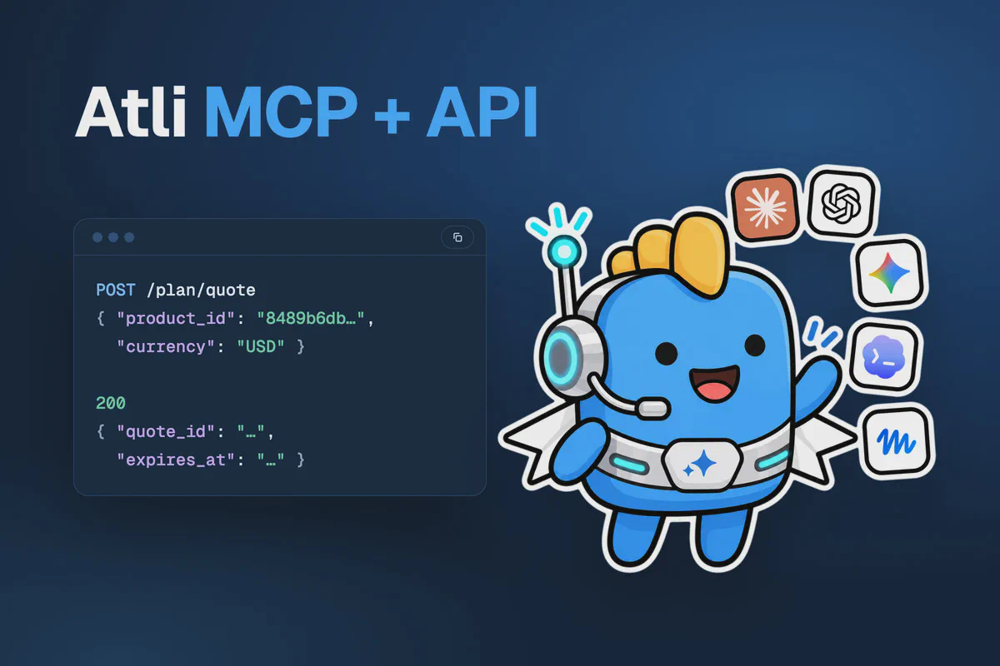
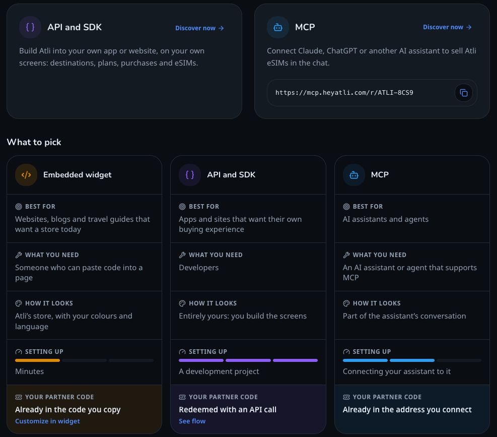
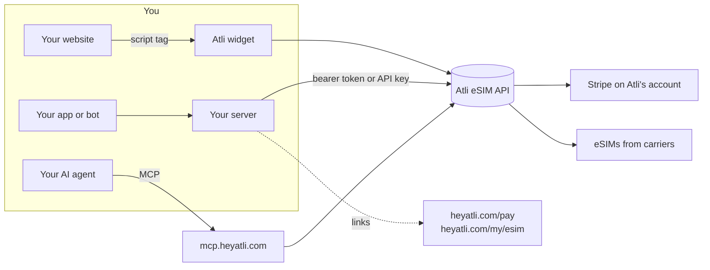
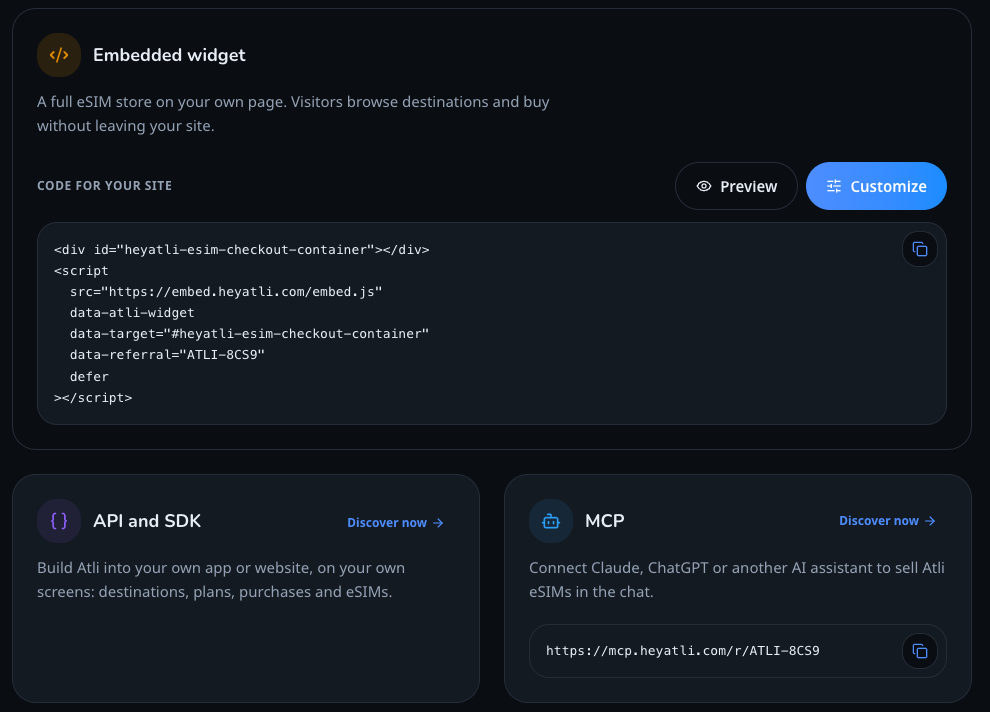
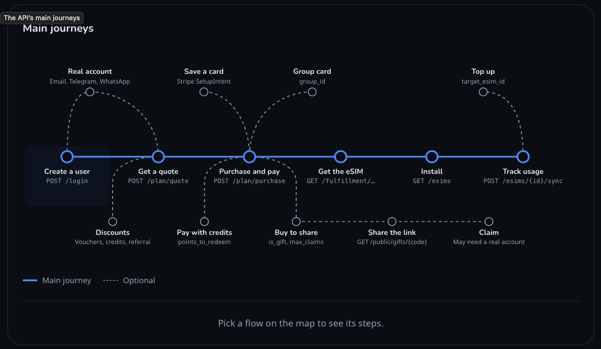
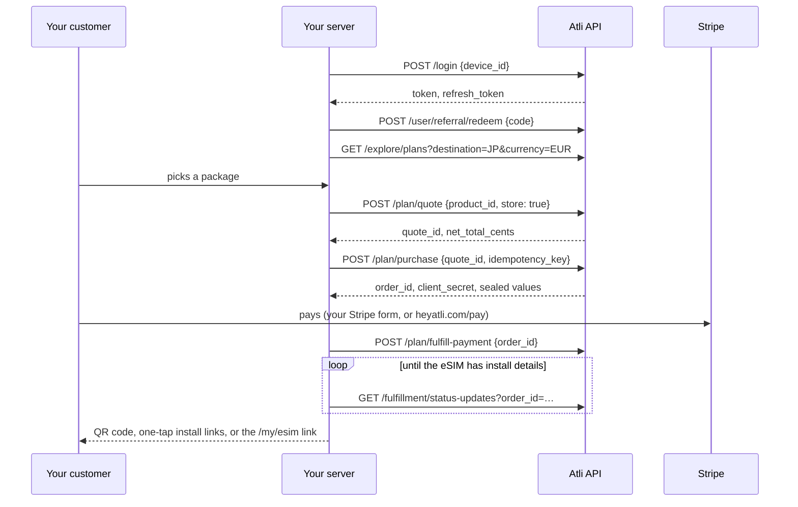

<p align="center">
  
</p>

<h1 align="center">eSIM API</h1>

<p align="center">
  <b>Build your own travel eSIM store, app, bot or agent on Atli.</b><br>
  White-label API, an embeddable widget you can restyle, hosted payment and install pages, OAuth and MCP.<br>
  200+ countries. No inventory, no carrier contracts, no card data on your servers.
</p>

<p align="center">
  <a href="#choose-your-integration">Choose your integration</a> ·
  <a href="#before-you-start">Before you start</a> ·
  <a href="#the-widget">The widget</a> ·
  <a href="#making-the-widget-your-own">Your own look</a> ·
  <a href="#the-white-label-api">The API</a> ·
  <a href="#business-models">Business models</a> ·
  <a href="#go-live-checklist">Go-live checklist</a> ·
  <a href="#resources">Resources</a> ·
  <a href="#faq">FAQ</a>
</p>

---

[Atli](https://heyatli.com) sells data-only travel eSIMs for single countries, regions and the whole world, through its
website, apps, WhatsApp, Telegram and AI assistants. Partners get the same catalogue, the same checkout and the same
eSIM delivery to build on:

- **Atli runs the hard parts:** the plan catalogue from many carriers, payments on Atli's Stripe account, issuing
  eSIMs, install links and QR codes, data-usage tracking, customer support and refunds.
- **You own the experience:** your brand, your pages, your app or bot, your audience. Start with one script tag, or
  build every screen yourself on the API.
- **You earn on what your customers buy:** commission of up to 20%, attributed to your account for good, paid monthly.
  Or buy with a prepaid balance and set your own prices.

This repository is a guide. Everything it describes is hosted by Atli, and every link below goes to the live
documentation, references and tools.

> [!TIP]
> Want an AI assistant to sell eSIMs instead? See [Forgesoft-ai/esim-mcp](https://github.com/Forgesoft-ai/esim-mcp) for Atli's MCP
> server.

## Choose your integration

<p align="center">
  <a href="https://partners.heyatli.com/dev"></a>
</p>

| Integration                                          | What you build                                       | Your look and feel                                  | Effort  |
| ---------------------------------------------------- | ---------------------------------------------------- | --------------------------------------------------- | ------- |
| [Referral links](#referral-links)                    | Nothing. Share links with your partner code          | Atli's                                              | Minutes |
| [Widget](#the-widget)                                | One script tag on your page: a whole eSIM store      | Your fonts, colours, corners and layout through CSS | An hour |
| [Hosted pages](#hosted-pages-you-can-send-people-to) | Links to Atli's payment and eSIM pages from your app | Language, theme, Atli logo off, page chrome off     | Hours   |
| [API](#the-white-label-api)                          | Every screen: search, checkout, install, usage       | Entirely yours                                      | Days    |
| [OAuth](#sign-in-with-atli)                          | "Sign in with Atli" in your app                      | Yours, with sign-in on heyatli.com                  | A day   |
| [MCP](#ai-assistants-mcp)                            | An AI agent or assistant that sells eSIMs            | The assistant's                                     | Minutes |

They combine. A common path is the widget on your site this week, then the API for your app once it's earning, with
the same partner code across all of them.



## Before you start

### 1. Get a partner account and code

Sign in at **[partners.heyatli.com](https://partners.heyatli.com)** with **Continue with Atli** (Google, Apple,
Facebook, WhatsApp, Telegram or email). Your partner account is created on the spot, with no application form, and your
**partner code** is on the Overview page.

- Codes have 6 to 16 letters, numbers and hyphens. You can change yours once every seven days, but the old code and
  every link carrying it stop working at once, so choose it before you publish.
- Commission terms are set per partner. Write to **partners@heyatli.com** to have yours set. The dashboard tracks
  referrals and purchases from day one, but shows earnings only once terms are in place.
- If the Overview says you have no code yet, write to the same address.

### 2. Know the two environments

|              | Sandbox                                        | Production                             |
| ------------ | ---------------------------------------------- | -------------------------------------- |
| API          | `https://api-staging.heyatli.com`              | `https://api.heyatli.com`              |
| OpenAPI      | `https://api-staging.heyatli.com/openapi.yaml` | `https://api.heyatli.com/openapi.yaml` |
| Payment page | `https://staging.heyatli.com/pay`              | `https://heyatli.com/pay`              |
| eSIM page    | `https://staging.heyatli.com/my/esim`          | `https://heyatli.com/my/esim`          |
| Widget       | `data-env="staging"`                           | the default                            |
| MCP          | `https://staging.public.mcp.heyatli.com`       | `https://mcp.heyatli.com`              |

Sandbox has **its own accounts** and takes **test payments only**: Stripe's `4242 4242 4242 4242`, any future expiry,
any CVC. Its eSIMs come from a test carrier and can't be installed on a phone, and its sales never earn commission.
Every page under [partners.heyatli.com/dev](https://partners.heyatli.com/dev) has a Sandbox/Production switch, and its
tools run against Sandbox for real.

### 3. Open the developer hub

**[partners.heyatli.com/dev](https://partners.heyatli.com/dev)** compares every integration on one page, with your
partner code already filled into each snippet once you're signed in.

<p align="center">
  <a href="https://partners.heyatli.com/dev"></a>
</p>

## Referral links

The no-code start. Add your code to any of these, from the **Ways to share** section of your dashboard:

| Opens                      | Link                                                 |
| -------------------------- | ---------------------------------------------------- |
| Atli website               | `https://heyatli.com/my/purchase?referral=YOUR_CODE` |
| Any heyatli.com page       | `https://heyatli.com/esim-japan?referral=YOUR_CODE`  |
| Atli app                   | `https://app.heyatli.com/c/YOUR_CODE`                |
| Atli chat on the web       | `https://chat.heyatli.com/r/YOUR_CODE`               |
| WhatsApp                   | `https://wa.me/14244453187?text=YOUR_CODE`           |
| Telegram                   | `https://t.me/AtliEsimBot?start=ref-YOUR_CODE`       |
| The widget as its own page | `https://embed.heyatli.com/?referral=YOUR_CODE`      |
| AI assistants (MCP)        | `https://mcp.heyatli.com/r/YOUR_CODE`                |

Website links keep your code in the visitor's browser for 30 days. Once someone signs in or buys with it, they are
yours for good (see [How attribution works](#how-attribution-works)).

## The widget

A complete eSIM store in one script tag: destination search, plan comparison, checkout, payment and the eSIM's QR code,
without visitors leaving your page. It's free to embed, needs no build step, and loads in a frame from
`embed.heyatli.com` that can't read your page, cookies or storage. The loader is about 17 KB, and the store itself loads
only as it scrolls into view.

**Build it visually:** [partners.heyatli.com/dev/atli-widget](https://partners.heyatli.com/dev/atli-widget) has every
setting, a live preview, and the code to copy. Signed in, **Integrations → Embedded widget** gives you the snippet with
your code already in it.

### Add it to a page

```html
<div id="heyatli-esim-checkout-container"></div>
<script
  src="https://embed.heyatli.com/embed.js"
  data-atli-widget
  data-target="#heyatli-esim-checkout-container"
  data-referral="YOUR_CODE"
  defer
></script>
```

It takes the container's full width and grows to its content's height, so there's no height to set. Leave out the
`<div>` and `data-target`, and it appears right after the script tag.

Open it on one destination, in your page's language and currency, for a country guide:

```html
<div id="japan-esim"></div>
<script
  src="https://embed.heyatli.com/embed.js"
  data-atli-widget
  data-target="#japan-esim"
  data-referral="YOUR_CODE"
  data-destination="jp"
  data-lang="de"
  data-lang-priority="widget"
  data-currency="EUR"
  defer
></script>
```

### Settings

Every setting is optional. In the script tag each is a `data-` attribute. In JavaScript it's the same name in camelCase
(`data-lang-priority` → `langPriority`).

| Attribute                | What it does                                                                                                                                                                                                 |
| ------------------------ | ------------------------------------------------------------------------------------------------------------------------------------------------------------------------------------------------------------ |
| `data-referral`          | Your partner code. New customers who buy are linked to you                                                                                                                                                   |
| `data-destination`       | Opens on a country code (`jp`), a country name in any language (`Japan`, `日本`), a region (`europe`, `south_east_asia`) or a plan ID, which opens its checkout                                              |
| `data-favorites`         | Up to 32 destinations for the **Top** tab, in your order: `"jp, kr, tw, asia"`                                                                                                                               |
| `data-lang`              | The widget's language. Defaults to the visitor's browser language                                                                                                                                            |
| `data-lang-priority`     | `widget` keeps your language over the visitor's choice and hides the language menu                                                                                                                           |
| `data-currency`          | Prices and payment currency. `USD` by default                                                                                                                                                                |
| `data-currency-priority` | `widget` keeps your currency over the visitor's choice                                                                                                                                                       |
| `data-theme`             | `light` or `dark`. Defaults to the visitor's device setting                                                                                                                                                  |
| `data-theme-priority`    | `widget` keeps your theme and hides the theme setting                                                                                                                                                        |
| `data-css`               | The `https://` address of your own stylesheet ([see below](#making-the-widget-your-own))                                                                                                                     |
| `data-boot`              | Opens on one of the visitor's screens: `esims`, `credits`, `vouchers`, `refer`, `settings`, `payment-methods`, `groups` or `profile`. `esim` opens a shared eSIM's install page, with its code in `data-lpa` |
| `data-anonymous-cards`   | `true` lets visitors who aren't signed in save a card in this browser                                                                                                                                        |
| `data-stripe-link`       | `false` removes Stripe Link from the payment form                                                                                                                                                            |
| `data-analytics`         | `off` stops the widget loading its own analytics                                                                                                                                                             |
| `data-consent`           | `all`, `analytics` or `none`, to match what your cookie banner collected                                                                                                                                     |
| `data-debug`             | `true` logs every widget event to the console                                                                                                                                                                |
| `data-env`               | `staging` runs it on Sandbox. Leave it out on a live page                                                                                                                                                    |

**Languages (15):** `en`, `pt`, `es`, `fr`, `it`, `de`, `pl`, `ru`, `zh`, `ko`, `ja`, `id`, `vi`, `ms`, `ar`.
**Currencies:** AUD, CAD, EUR, GBP, HKD, JPY, KRW, SGD, TWD, USD, VND. Unsupported values are ignored.

### Single-page apps

In React, Vue, Next.js or anything that changes pages without a reload, load the script once and mount the widget from
code:

```html
<script src="https://embed.heyatli.com/embed.js"></script>
```

```js
const widget = HeyAtli.init({
  target: "#esim", // a selector or an element
  referral: "YOUR_CODE",
  destination: "jp",
  lang: "de",
  currency: "EUR",
});

widget.update({ destination: "th" }); // merges settings, no reload
widget.destroy(); // when the page goes away
```

```jsx
import { useEffect, useRef } from "react";

export function EsimStore({ destination }) {
  const ref = useRef(null);
  useEffect(() => {
    const widget = window.HeyAtli.init({
      target: ref.current,
      referral: "YOUR_CODE",
      destination,
    });
    return () => widget.destroy(); // Strict Mode mounts twice in development
  }, [destination]);
  return <div ref={ref} />;
}
```

Two widgets on one page work too: give each its own container.

### Making the widget your own

The widget is built to take your brand. Point `data-css` (or `css` in `init()`) at a stylesheet on your own site:

```html
<script
  src="https://embed.heyatli.com/embed.js"
  data-atli-widget
  data-referral="YOUR_CODE"
  data-css="https://your-site.com/css/atli-widget.css"
  defer
></script>
```

The widget loads it **inside its frame, after its own styles**, so plain selectors win with no `!important`. If the
file fails to load, the widget keeps its default look.

**Step 1: set the design tokens.** Most of the job is overriding `--atli-*` custom properties on `.atli-widget`. Every
component follows them. Visitors can see either theme, so cover dark too:

```css
/* Light */
.atli-widget {
  --atli-font-family: "Inter", system-ui, sans-serif;

  --atli-color-bg: #fffaf4;
  --atli-color-surface: #ffffff;
  --atli-color-surface-hover: #fff1e2;
  --atli-color-surface-sunken: #fdeedd;
  --atli-color-border: #f2dcc4;
  --atli-color-border-strong: #e0bd97;

  --atli-color-text: #2b1a10;
  --atli-color-text-muted: #7d604b;
  --atli-color-text-faint: #a98a72;

  --atli-color-accent: #d1471f;
  --atli-color-accent-hover: #b03a17;
  --atli-color-accent-text: #fffaf4;
  --atli-color-accent-soft: #ffe6d8;

  --atli-color-badge-bg: #fdeedd;
  --atli-color-badge-text: #8a5a37;

  --atli-radius-sm: 3px;
  --atli-radius-md: 4px;
  --atli-radius-lg: 6px;
}

/* Dark */
.atli-widget[data-theme="dark"] {
  --atli-color-bg: #1a1008;
  --atli-color-surface: #241710;
  --atli-color-text: #f8ece0;
  --atli-color-accent: #ff8a4c;
  --atli-color-accent-hover: #ffa370;
  --atli-color-accent-text: #1a1008;
  /* …and the rest of the set above */
}
```

**Step 2: restyle components** for what tokens can't express (shape, spacing, typography), through the widget's
semantic classes, such as `.atli-header__title`, `.atli-section__title`, `.atli-card`, `.atli-card--region` and
`.atli-button`.

**Step 3: start from a worked example.** Two complete, commented themes cover every common token and class. Copy one
to your site and edit it:

- [`sunset.css`](https://embed.heyatli.com/themes/sunset.css): warm serif, rounded down
- [`mono.css`](https://embed.heyatli.com/themes/mono.css): monochrome

**Step 4: lock it in.** `data-theme` with `data-theme-priority="widget"` keeps one theme and hides its switch, and the
same goes for language and currency.

**What carries over, and what doesn't:**

- **The card form follows you.** Card fields sit in Stripe's own frame, where no stylesheet reaches, so the widget hands
  Stripe your accent, text and surface colours, font and corner radius instead.
- **The footer stays.** Every screen ends with **Powered by Atli | Support**. A stylesheet that hides, fades, clips or
  covers it is dropped for the rest of the visit, the widget returns to its default look, and the console says why.
- **For total control,** build the screens yourself on [the API](#the-white-label-api).

### Track purchases

Listen for widget events, for example to send purchases to GA4 through Google Tag Manager:

```js
const widget = HeyAtli.init({ target: "#esim", referral: "YOUR_CODE" });

widget.on("purchase.completed", (detail) => {
  window.dataLayer = window.dataLayer || [];
  window.dataLayer.push({ ecommerce: null });
  window.dataLayer.push({
    event: "purchase",
    ecommerce: {
      transaction_id: detail.transactionId,
      value: detail.value, // 12.99, not 1299
      currency: detail.currency,
      items: detail.items, // already in GA4's item format
    },
  });
});
```

Other events include `checkout.opened`, `payment.started` and `payment.failed`. Handlers get `(detail, info)`, with the
event's name in `info.action`, so `widget.on('*', handler)` forwards them all.

Events reach only domains on Atli's allowlist. `heyatli.com` and `localhost` are on it, so you can build locally, but a
handler that works on `localhost` will go quiet on your live site until you ask **partners@heyatli.com** to add your
domain. Purchases work either way.

### Test it

Add `data-env="staging"` (or `env: 'staging'`). A Sandbox tag shows in the corner and your code appears faintly in the
test banner, so you can check it was picked up. **Remove it before going live:** Sandbox takes only test cards.

## Hosted pages you can send people to

When you build your own front end but don't want to handle cards or install screens, link to Atli's pages. Both work
with no Atli account. The guides are at [partners.heyatli.com/dev/pages](https://partners.heyatli.com/dev/pages) and
[partners.heyatli.com/dev/payment-widget](https://partners.heyatli.com/dev/payment-widget).

### Payment page: `heyatli.com/pay`

For bots, voice apps, AI agents, or any app that can't show Stripe's form. It takes cards, Apple Pay, Google Pay and
3-D Secure, shows the order total, and the card never reaches you. Build the link from the sealed values that
`POST /plan/purchase` returns:

```js
const link = new URL("https://heyatli.com/pay"); // staging.heyatli.com/pay on Sandbox
link.search = new URLSearchParams({
  type: "payment_intent", // or 'setup_intent' to save a card
  sealed_secret: order.sealed_secret,
  key_id: order.key_id,
  seal_signature: order.seal_signature,
  ...(order.options && {
    options: Buffer.from(order.options).toString("base64url"), // shows e.g. "Plan for Japan"
    options_signature: order.options_signature,
  }),
  brand: "none", // hide the Atli logo
  lang: "de",
  theme: "dark",
}).toString();
```

- Pass the sealed values **exactly** as returned. Only `options` gets base64url-encoded.
- Never put a plain `client_secret` in a link. Send the link only to the person paying, keep it out of logs, and don't
  store it: a new purchase cancels the earlier pending order.
- Return addresses accept only `https` on heyatli.com, so tell people to come back to your app or chat when they've paid.
- The page shows "processing" as success, so confirm with `POST /plan/fulfill-payment`, repeating until paid.
- The Cancel button leaves the order open. Cancel it with `POST /orders/{id}/cancel`.

### eSIM page: `heyatli.com/my/esim`

One link that installs an eSIM and then tracks it: the QR code, one-tap iPhone and Android install links, the manual
details, and, with the ICCID, its plans and data left.

```text
https://heyatli.com/my/esim?lpa=<qr_string as base64url>&iccid=<ICCID>&bare
```

- `bare` drops heyatli.com's header and footer, so the page sits inside your app or flow.
- Put a language in the path (`/ja/my/esim`), and use `staging.heyatli.com` for a Sandbox eSIM.
- Anyone with the link can install the eSIM, so send it only to the person who'll use it.
- The widget opens the same page with `data-boot="esim"` and `data-lpa`.

## The white-label API

The same API that runs heyatli.com and the widget. Build your own destination pages, plan picker, checkout, install
and usage screens, in a website, app or bot, under your brand. Atli provides the catalogue, takes payment on its Stripe
account and issues the eSIMs.

- **Start here:** [partners.heyatli.com/dev/api](https://partners.heyatli.com/dev/api), with a clickable map of every
  journey, step by step with code.
- **Reference:** [API reference](https://partners.heyatli.com/dev/api/reference-api-heyatli-com) with a try-it panel
  and a Sandbox/Production switch.
- **Spec:** [`openapi.yaml`](https://api.heyatli.com/openapi.yaml) (OpenAPI 3.0).
- **Long-form guide:** [How to integrate the Atli eSIM API into your website or app](https://heyatli.com/blog/esim-api-integration/).

<p align="center">
  <a href="https://partners.heyatli.com/dev/api"></a>
</p>

### Ground rules

- **Call it from your server.** Browsers may call the API only from Atli's own sites, so requests from your web page are
  refused. Keep tokens and keys on your server and have your front end call it.
- **A token identifies a person, not an application.** There are three ways to get one:

  | Who the calls act for                               | How                                                            | Use it for                                                             |
  | --------------------------------------------------- | -------------------------------------------------------------- | ---------------------------------------------------------------------- |
  | Each of your users, as an Atli **guest**            | `POST /login` with a `device_id` you create and store per user | A white-label store where customers never see an Atli sign-up          |
  | Each of your users, with **their own Atli account** | [OAuth 2.1](#sign-in-with-atli), authorization code with PKCE  | Apps where people already have, or want, an Atli account               |
  | **Your own** partner account                        | An [API key](https://partners.heyatli.com/dev/api/keys)        | Scripts and servers acting as you: buying with your balance, reporting |

- **Errors** always have the same body: a stable `code`, an English `message`, a `trace_id` for support, and sometimes
  `params`. Branch on `code`, never on `message`, and treat a code you don't know as its HTTP status.
- **Rate limits.** Sign-in, refresh, email codes, vouchers, quotes and eSIM sync are throttled. A `429` comes with
  `Retry-After` in seconds. Wait it out instead of looping.
- **Language and currency.** Send `X-Locale` (or `Accept-Language`, or `?lang=`). Prices are in USD unless you send a
  `currency`. The one on a person's profile isn't applied for you.
- **Enums grow.** Treat an unknown value as one you don't handle yet, never as a parse failure.
- **Versioning.** Paths are unversioned. A breaking change comes under a new base URL.

### Generate a typed client

```bash
docker run --rm -v "$PWD:/out" \
  openapitools/openapi-generator-cli generate \
  -i https://api.heyatli.com/openapi.yaml \
  -g typescript-fetch -o /out/atli-sdk
```

Swap `typescript-fetch` for `python`, `java`, `csharp`, `php` or `swift6`. For Go, use
`go --additional-properties=enumClassPrefix=true`.

### The core flow



All examples use Sandbox. For production, change the base URL to `https://api.heyatli.com`.

#### 1. Create a user

Make one random ID per customer (`crypto.randomUUID()`), store it on their record, and treat it like a password: anyone
who has it can sign in as them. A new ID creates a guest, and a known one signs back in.

```bash
curl https://api-staging.heyatli.com/login \
  -H 'Content-Type: application/json' \
  -d '{ "device_id": "YOUR_DEVICE_ID" }'
```

```json
{
  "token": "eyJhbGci…",
  "refresh_token": "…",
  "expires_in": 900,
  "session_id": "…",
  "user": { "id": "…", "email": null }
}
```

Send `Authorization: Bearer <token>`. It lasts 15 minutes. Renew it with `POST /refresh` and the `refresh_token`. The
answer names the new token `access_token`, not `token`, and comes with a new refresh token that retires the old one, so
save it every time. Lose both, and sign in with the device ID again.

To give a guest a real account (some shared eSIMs and vouchers need one), send its token **and** `device_id` to
`POST /auth/email/otp`, then `POST /auth/email/verify`. WhatsApp and Telegram sign-in upgrade it the same way. The guest
keeps everything.

#### 2. Link the user to your partner code

Right after creating them, before their first quote:

```bash
curl https://api-staging.heyatli.com/user/referral/redeem \
  -H 'Authorization: Bearer YOUR_TOKEN' \
  -H 'Content-Type: application/json' \
  -d '{ "code": "YOUR_PARTNER_CODE" }'
```

`result` is `ok` (linked), `already` (has a referrer), `notnew` (bought before), `own` (your own code) or `notfound`.
The link is permanent, and if your code carries a discount, their first eSIM gets it without sending the code again.

#### 3. Show plans and quote

`GET /explore/plans` returns the whole catalogue (destinations, packages, prices, data) and needs no token, so you can
list plans before anyone has an account. Filter by `destination` (`JP`, `europe`) or `category` (`local`, `regional`,
`global`):

```bash
curl 'https://api-staging.heyatli.com/explore/plans?currency=EUR&destination=JP'
```

A package's `id` is the `product_id` you quote:

```bash
curl https://api-staging.heyatli.com/plan/quote \
  -H 'Authorization: Bearer YOUR_TOKEN' \
  -H 'Content-Type: application/json' \
  -d '{ "product_id": "THE_PACKAGE_ID", "currency": "EUR", "store": true }'
```

```json
{
  "subtotal_cents": 1500,
  "total_discount_cents": 150,
  "net_total_cents": 1350,
  "currency": "EUR",
  "quote_id": "…",
  "expires_at": "…"
}
```

Show `net_total_cents` as the price. A stored quote lasts 30 minutes, and each user holds one at a time.

Quote options: `target_esim_id` tops up an eSIM they already have. `auto_apply_best_voucher`, `voucher_code` and
`points_to_redeem` apply discounts. An order takes one kind of discount, and your referral discount comes first.

#### 4. Buy and take payment

```bash
curl https://api-staging.heyatli.com/plan/purchase \
  -H 'Authorization: Bearer YOUR_TOKEN' \
  -H 'Content-Type: application/json' \
  -d '{ "quote_id": "THE_QUOTE_ID", "idempotency_key": "A_NEW_UUID" }'
```

```json
{
  "order_id": "…",
  "client_secret": "pi_…_secret_…",
  "sealed_secret": "…",
  "key_id": "…",
  "seal_signature": "…",
  "options": "{\"message\":\"Plan for Japan\",\"lang\":\"en\"}",
  "options_signature": "…",
  "total_amount_cents": 1350,
  "status": "pending_payment"
}
```

The same `idempotency_key` never buys twice, so retries are safe. If the price has moved more than 1% since the quote,
you get `price_changed`: quote again.

Then take the payment one of two ways:

- **On Atli's page:** build a [`/pay` link](#payment-page-heyatlicompay) from the sealed values. Nothing to render.
- **In your own page,** with Stripe's Payment Element. Your server reads the publishable key from `GET /stripe/config`
  (it differs between environments, and the page can't call the API itself) and hands it to the page with the
  `client_secret`, which goes only to the paying customer's session and never into logs:

  ```js
  const stripe = Stripe(publishable_key);
  const elements = stripe.elements({ clientSecret: order.client_secret });
  elements.create("payment").mount("#pay");
  const { error } = await stripe.confirmPayment({
    elements,
    confirmParams: { return_url: window.location.href },
    redirect: "if_required",
  });
  ```

Once paid, call `POST /plan/fulfill-payment` with the `order_id`. If that call fails, **don't charge again**: Atli
finishes a paid order on its own. Add `payment_method_id` to a purchase to charge a saved card, or `save_card: true` to
keep a new one.

#### 5. Deliver the eSIM

```bash
curl 'https://api-staging.heyatli.com/fulfillment/status-updates?order_id=THE_ORDER_ID' \
  -H 'Authorization: Bearer YOUR_TOKEN'
```

Poll until `status` is `completed` and `esim` has its install details (`paid` means paid but not yet issued). Then:

```js
const lpa = `LPA:1$${esim.lpa_address}$${esim.activation_code}`;
const carddata = encodeURIComponent(lpa);
const iphone = `https://esimsetup.apple.com/esim_qrcode_provisioning?carddata=${carddata}`;
const android = `https://esimsetup.android.com/esim_qrcode_provisioning?carddata=${carddata}`;
// Or draw esim.qr_string as a QR code, or send the /my/esim link
```

`GET /esims` lists a user's eSIMs with their plans and data used as of the last sync. `POST /esims/{id}/sync` asks the
network for fresh figures. It's throttled, so call it when the customer asks, not on a timer.

### More journeys

Each has a step-by-step guide on the [journey map](https://partners.heyatli.com/dev/api):

| Journey          | Key calls                                                                                                        |
| ---------------- | ---------------------------------------------------------------------------------------------------------------- |
| Top up           | Quote with `target_esim_id`. `incompatible_esim` if that eSIM's network doesn't sell the plan                    |
| Save a card      | `POST /user/payment-methods/setup-intent`, `/pay` with `type=setup_intent`, `POST /user/payment-methods/confirm` |
| Discounts        | `POST /rewards/voucher/redeem`, `voucher_code`, `auto_apply_best_voucher`, `points_to_redeem` in the quote       |
| Pay with credits | `points_to_redeem` in the quote. A $0 order comes back `paid` with no `client_secret`: skip payment              |
| Buy to share     | Quote with `is_gift: true` and `max_claims` (1–20), then read `claim_url` from `GET /gifts/sent`                 |
| Claim            | Claim a shared plan onto the recipient's eSIM. `gift_sign_in_required` means a guest needs a real account        |
| Group card       | Quote with `group_id` to buy on an [Atli Groups](https://groups.heyatli.com) card at the group's price           |
| Real account     | `POST /auth/email/otp` and `/auth/email/verify` with the guest's `device_id`                                     |

There's also a small public [UI API](https://partners.heyatli.com/dev/api/reference-heyatli-com) (destinations,
devices) that heyatli.com's own pages use.

### Sign in with Atli

For apps where people use their own Atli account: OAuth 2.1, authorization code with PKCE (`S256`), rotating refresh
tokens and revocation. People sign in on heyatli.com, so you never handle their password.

1. Register a client at [partners.heyatli.com/dev/oauth/clients](https://partners.heyatli.com/dev/oauth/clients): up
   to 10, `public` for phone apps or `confidential` for a server that keeps a secret. A web app needs a server and a
   confidential client, since its page can't call the token endpoint.
2. Read the endpoints from metadata rather than hard-coding them:

   ```bash
   curl https://api.heyatli.com/.well-known/oauth-authorization-server
   ```

3. Access tokens last 15 minutes. Each refresh returns a new refresh token that replaces the old one.
4. Link new users to your code with `POST /user/referral/redeem` and their token, as in step 2.

The [OAuth guide](https://partners.heyatli.com/dev/oauth) has the whole flow, with a **Test sign-in** button that runs
it against Sandbox.

### API keys

For a script or server acting as **your own** account. Create keys at
[partners.heyatli.com/dev/api/keys](https://partners.heyatli.com/dev/api/keys) (or `POST /user/api-keys`) and send them
like a token: `Authorization: Bearer <key>`.

- The whole key is shown **once**. Only a hash is kept, so store it straight away.
- Keys don't expire unless you choose an expiry (30 days, 90 days, a year, or a date). You can hold 25 active keys.
- A key can do everything your account can, except create or revoke keys, so a leaked key can't mint more.
- Keys are revoked, never edited. Errors to expect: `invalid_api_key`, `api_key_revoked`, `api_key_expired`.

### AI assistants (MCP)

To sell through ChatGPT, Claude, Gemini, Muse or your own agent with no code, give people
`https://mcp.heyatli.com/r/YOUR_CODE`. Details: [partners.heyatli.com/dev/mcp](https://partners.heyatli.com/dev/mcp),
the [tool reference](https://partners.heyatli.com/dev/mcp/reference) with a Sandbox **Try** button on every tool, and
[Forgesoft-ai/esim-mcp](https://github.com/Forgesoft-ai/esim-mcp).

## White-label: what's yours and what stays Atli's

| Yours                                                                      | Stays Atli's                                                                          |
| -------------------------------------------------------------------------- | ------------------------------------------------------------------------------------- |
| Every screen, on the API: brand, copy, flow, domain                        | The **Powered by Atli \| Support** footer, in the widget only                         |
| Widget fonts, colours, corners, layout, theme, language and currency       | Card fields inside Stripe's frame (they take your colours, font and radius)           |
| Payment page language and theme, with the Atli logo off (`brand=none`)     | The merchant: Atli's name on card statements, with refunds and disputes going to Atli |
| eSIM page without heyatli.com's header and footer (`bare`)                 | eSIM issuing, carriers and customer support                                           |
| Which destinations you feature, and the order                              | The catalogue's full list, which customers can still search in the widget             |
| Your own retail price, in the [prepaid model](#2-prepaid-balance-reseller) | Prices in the per-customer model, which match Atli's store                            |

Apple Pay and Google Pay are on Atli's payment page and in the widget already. To offer them in a Stripe form of your
own, write to **partners@heyatli.com** once your integration has real sales behind it.

## Business models

### 1. Per-customer accounts (commission)

Each of your customers is an Atli guest (or account) linked to your partner code. They pay Atli's prices on Atli's
Stripe, and you earn commission on what they buy, for good. This is what the widget, referral links, the MCP address
and the [core flow](#the-core-flow) give you.

- **Up to 20%** commission on net sales (after refunds), set individually: a percentage, or a percentage with a minimum
  per purchase, optionally with a minimum order value. Higher volume earns more.
- **Paid monthly.** A refund takes back the commission recorded on that purchase.
- **A discount on your code** applies to each new customer's first eSIM.

### 2. Prepaid balance (reseller)

Top up **Atli Credits** by card from your partner account, and the balance pays for plans: for your customers' eSIMs
or your team's trips (see [heyatli.com/atli/credits](https://heyatli.com/atli/credits) and
[heyatli.com/business](https://heyatli.com/business)). With an [API key](#api-keys), your server quotes with
`points_to_redeem`, and when credits cover the whole order it's a $0 order, `paid` at once, with no card and no
payment step. You charge your customer however and whatever you like, and hand them the install link.

- By default credits pay part of an order (usually 20–40%, by order size, with a $2 minimum). **Atli lifts the cap
  for selected partners**, so credits can pay whole orders. Ask **partners@heyatli.com**.
- eSIMs bought this way belong to your account. Deliver them with the [`/my/esim` link](#esim-page-heyatlicommyesim),
  or buy them [to share](#more-journeys) and send the `claim_url`.

### 3. Companies paying for their people

For corporate travel, [Atli Groups](https://groups.heyatli.com) puts everyone's eSIMs on one card with a limit for
each person, and your integration can buy on a group's card with `group_id`. See
[Atli Groups: let your team buy travel eSIMs on one card](https://heyatli.com/blog/atli-groups-esim-for-teams/).

### How attribution works

Atli attributes by **account**, not by click window. Once an eligible customer signs in or buys with your code, they're
linked to you, and every later purchase on that Atli account counts for you, across the website, apps, WhatsApp,
Telegram, the widget and AI assistants, even if they never use your code again.

- The first eligible code wins. Someone already linked to another partner, or who bought before, can't be linked.
- Website links remember your code for 30 days, and the widget for 72 hours.
- Sandbox sales never earn.

### Growing it

- **Statistics** in your dashboard: referrals, purchases, refunds, sales, net sales and earnings, by day, week or month
  (in UTC). **Sign-ups** and **Purchases** export to CSV.
- **Vouchers** for launches, events and seasons: fixed, percentage (with a cap) or bonus credits, limited by new
  customers, first order, minimum spend, channel, destination, uses, dates, or invited emails, domains and handles.
  Request them from the **Vouchers** page. Each has a **Get link** for the chat, WhatsApp and Telegram.
- **Share eSIMs** with your audience from the **Share eSIM** page, and follow claims on **Redemptions** (verified
  partners).

Full terms: [How the Atli affiliate program pays for eSIM referrals](https://heyatli.com/blog/atli-affiliate-program/) and
[heyatli.com/affiliate](https://heyatli.com/affiliate).

## Go-live checklist

- [ ] Partner code chosen, and commission terms (or an uncapped balance) agreed with partners@heyatli.com.
- [ ] Every flow run end to end on **Sandbox** with `4242 4242 4242 4242`.
- [ ] `data-env="staging"` removed and base URLs switched to `https://api.heyatli.com`, `https://heyatli.com/pay` and
      `https://heyatli.com/my/esim`.
- [ ] New users linked with `POST /user/referral/redeem` before their first quote.
- [ ] Device IDs, tokens, refresh tokens and API keys only on your server, encrypted, never in logs or URLs.
- [ ] Refresh tokens replaced on every refresh. The refresh answer's `access_token` read, not `token`.
- [ ] An `idempotency_key` on every purchase. No second charge when `fulfill-payment` fails.
- [ ] Errors handled by `code`. `429` waits out `Retry-After`. Unknown codes and enum values don't crash.
- [ ] Your live domain on the widget's event allowlist, if you track purchases.
- [ ] Your widget stylesheet tested in **both** themes, and the Atli footer visible.

## Resources

### Developer hub ([partners.heyatli.com/dev](https://partners.heyatli.com/dev))

| Page                                                                            | What's there                                                  |
| ------------------------------------------------------------------------------- | ------------------------------------------------------------- |
| [Integrations](https://partners.heyatli.com/dev)                                | Every integration compared, with your code in each snippet    |
| [API and SDKs](https://partners.heyatli.com/dev/api)                            | How the API works, and the journey map with step-by-step code |
| [API reference](https://partners.heyatli.com/dev/api/reference-api-heyatli-com) | Every endpoint, with a try-it panel and the downloadable spec |
| [My API keys](https://partners.heyatli.com/dev/api/keys)                        | Create and revoke keys for your account                       |
| [UI API reference](https://partners.heyatli.com/dev/api/reference-heyatli-com)  | heyatli.com's small public API                                |
| [Atli Widget](https://partners.heyatli.com/dev/atli-widget)                     | Widget builder with live preview                              |
| [Payment Widget](https://partners.heyatli.com/dev/payment-widget)               | Building `/pay` links, with a live Sandbox payment            |
| [OAuth](https://partners.heyatli.com/dev/oauth)                                 | Sign in with Atli: flows, tokens, errors                      |
| [My OAuth clients](https://partners.heyatli.com/dev/oauth/clients)              | Register clients and run a test sign-in                       |
| [MCP Server](https://partners.heyatli.com/dev/mcp)                              | Connect AI assistants with your code                          |
| [MCP reference](https://partners.heyatli.com/dev/mcp/reference)                 | Every MCP tool, with Try on Sandbox                           |
| [Pages: eSIM display and tracking](https://partners.heyatli.com/dev/pages/esim) | The `/my/esim` link, part by part                             |

### Machine-readable

| What                  | Sandbox                                                                | Production                                                                                                       |
| --------------------- | ---------------------------------------------------------------------- | ---------------------------------------------------------------------------------------------------------------- |
| OpenAPI spec          | https://api-staging.heyatli.com/openapi.yaml                           | https://api.heyatli.com/openapi.yaml                                                                             |
| OAuth server metadata | https://api-staging.heyatli.com/.well-known/oauth-authorization-server | https://api.heyatli.com/.well-known/oauth-authorization-server                                                   |
| UI API spec           | https://staging.heyatli.com/api/openapi.yaml                           | https://heyatli.com/api/openapi.yaml                                                                             |
| Widget loader         | `embed.js` with `data-env="staging"`                                   | https://embed.heyatli.com/embed.js                                                                               |
| Widget themes         |                                                                        | [sunset.css](https://embed.heyatli.com/themes/sunset.css), [mono.css](https://embed.heyatli.com/themes/mono.css) |
| MCP server            | https://staging.public.mcp.heyatli.com                                 | https://mcp.heyatli.com                                                                                          |

### Guides on the Atli blog

- [How to integrate the Atli eSIM API into your website or app](https://heyatli.com/blog/esim-api-integration/)
- [Add an eSIM widget to your website with one script tag](https://heyatli.com/blog/esim-widget-for-websites/)
- [Connect an AI assistant to the Atli eSIM MCP server](https://heyatli.com/blog/esim-mcp-server/)
- [How the Atli affiliate program pays for eSIM referrals](https://heyatli.com/blog/atli-affiliate-program/)
- [Atli Groups: let your team buy travel eSIMs on one card](https://heyatli.com/blog/atli-groups-esim-for-teams/)
- [Atli brings travel eSIMs to ChatGPT, Claude and Muse](https://heyatli.com/blog/atli-mcp-api-launch/): the launch

### Related repositories

- [Forgesoft-ai/esim-mcp](https://github.com/Forgesoft-ai/esim-mcp): connect Claude, ChatGPT, Gemini, Cursor or any MCP client to
  Atli's eSIM MCP server, with the MCP reference and Sandbox to try every tool

### Atli

- [Partners dashboard](https://partners.heyatli.com) · [Atli for Business](https://heyatli.com/business) ·
  [Atli Credits](https://heyatli.com/atli/credits) · [Atli Groups](https://groups.heyatli.com) ·
  [Affiliate program](https://heyatli.com/affiliate)
- [Security](https://heyatli.com/security) · [Terms](https://heyatli.com/terms) · [Privacy](https://heyatli.com/privacy)
- Partners and integrations: **partners@heyatli.com** · Customer help: [chat.heyatli.com/help](https://chat.heyatli.com/help)

## FAQ

<details>
<summary><b>Do I need my own Stripe account?</b></summary>

No. Orders are charged on Atli's Stripe account. Your form uses Atli's publishable key from `GET /stripe/config`, and
card details go straight to Stripe, never to your servers or the API. In the prepaid model, you charge your customers
with whatever you already use.

</details>

<details>
<summary><b>Does the API have an application key?</b></summary>

No application key. Tokens and keys identify a person: each of your customers (a guest by device ID, or their own
account through OAuth), or you, with an API key for your own account.

</details>

<details>
<summary><b>Can I call the API from my web page?</b></summary>

No. Browser requests from other sites are refused (`403`). Call it from your server. The widget and the hosted pages
are how a page works with Atli without a server.

</details>

<details>
<summary><b>Can I set my own prices?</b></summary>

In the per-customer model, customers pay Atli's prices and you earn commission. With a prepaid balance, you buy with
credits and charge your customers what you choose.

</details>

<details>
<summary><b>Can I hide Atli completely?</b></summary>

On the API, your screens are entirely yours, and the payment page drops the logo with `brand=none`. Atli remains the
merchant, so its name is on card statements. The widget always shows a small "Powered by Atli | Support" footer.

</details>

<details>
<summary><b>Can I limit the widget to the countries I cover?</b></summary>

Partly. `data-destination` opens it on one, and `data-favorites` fills the Top tab with up to 32 of yours. Visitors can
still search the full catalogue. For a fixed list, build on the API.

</details>

<details>
<summary><b>How do I add data to an eSIM a customer already has?</b></summary>

Quote with `target_esim_id` set to that eSIM and buy as usual. Nothing new to install. If its network doesn't sell the
package, the quote says `incompatible_esim` before any payment.

</details>

<details>
<summary><b>The payment went through but my fulfil call failed. Now what?</b></summary>

Don't charge again. Atli finishes a paid order on its own. Keep polling `GET /fulfillment/status-updates`.

</details>

<details>
<summary><b>Who handles customer support and refunds?</b></summary>

Atli, at [chat.heyatli.com/help](https://chat.heyatli.com/help). Refunds and disputes go to Atli, as the merchant.

</details>

## License

The documentation in this repository is released under the [MIT License](LICENSE). The Atli service, its API, brand
and mascot belong to Atli.
